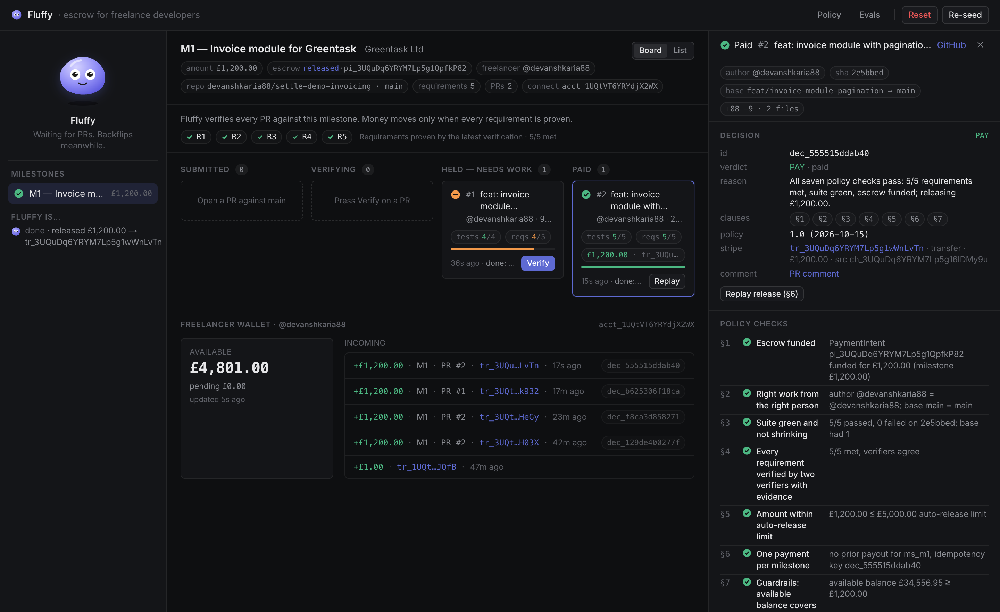
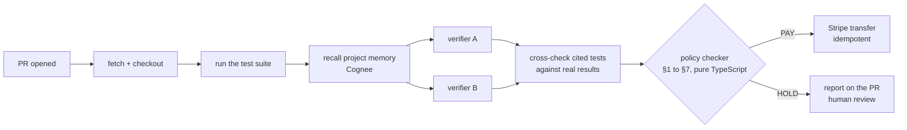
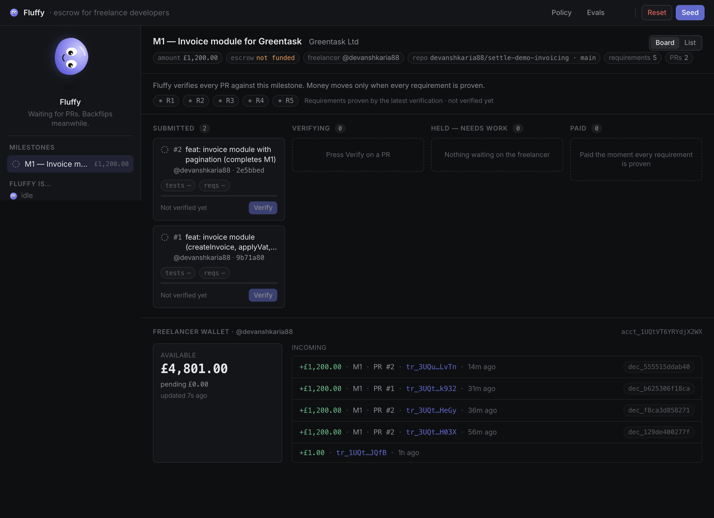
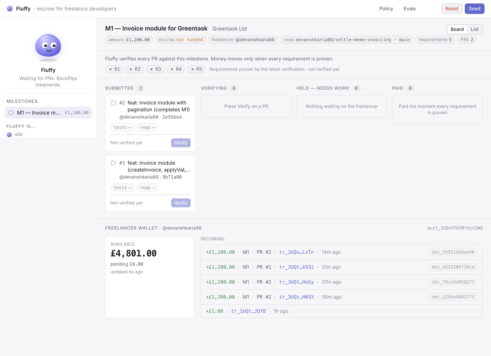
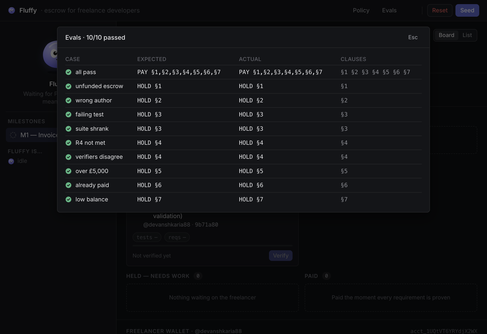

<div align="center">



# Fluffy

**The escrow agent that pays freelancers the moment the work is provably done.**

Briefcase × Stripe hackathon, London, 15 October 2026. Track 01: Agents that Spend.


</div>

## The problem

Freelance developers get paid late, or not at all, for work that was done. Clients sit on PRs, dispute scope after the fact, and "net 30" turns into net 90. Escrow fixes the trust problem but adds a human arbiter, and arbiters are slow and expensive.

Fluffy replaces the arbiter with verification. The milestone document is the contract. The client funds escrow up front. When the freelancer opens a PR, Fluffy runs the tests, has two independent verifiers prove every requirement with cited evidence, applies a seven-clause written policy, and releases the escrow as a Stripe Connect transfer. No invoice, no chasing.

If you build with AI, this flips the loop: optimise your PR against the same tests the escrow agent uses, and you get paid the second they pass.

## What happens on a PR



Two verifiers (claude-haiku-5-5, different personas) each assess every requirement and have to cite a named passing test. They have to agree. If a cited test did not run or did not pass, the evidence is void. Code checks that, not the model.

The policy checker is a pure function. The language models verify and cite; they never decide whether money moves.

Money moves on Stripe, in test mode. The client funds escrow with a PaymentIntent. The release is a Connect transfer to the freelancer's account, funded by that specific charge (`source_transaction`), with the decision id as the idempotency key and the policy clauses in the metadata.

Every decision carries its evidence: per-requirement verdicts, both verifier reports, the §1 to §7 check table, the memory facts used, the Stripe object, the GitHub comment, and a timeline. It all shows on the dashboard and gets posted as a comment on the PR.

Cognee is the project's memory. The milestone, the policy and the client's acceptance history are seeded as a graph. Fluffy recalls them before verifying and writes every outcome and reviewer note back, so the next decision cites the last one.

## The dashboard

<table>
  <tr>
    <td width="50%"></td>
    <td width="50%"></td>
  </tr>
  <tr>
    <td align="center"><sub>Dark, the default</sub></td>
    <td align="center"><sub>Light, from the toggle in the top bar</sub></td>
  </tr>
</table>

PRs move across Submitted, Verifying, Held and Paid. The requirements strip shows which of R1 to R5 the latest verification proved. The wallet at the bottom is the freelancer's real Connect balance plus every transfer that has landed there, read straight from Stripe. Fluffy's face in the sidebar reacts to whatever the agent is doing, which is mostly backflips while it waits for PRs.

## The policy

[policy/escrow-policy.md](policy/escrow-policy.md) is the whole rulebook. Seven clauses.

| Clause | Rule |
|---|---|
| §1 | Escrow is funded for at least the milestone amount, as a succeeded PaymentIntent |
| §2 | The PR targets the agreed repo and base branch and is authored by the contracted freelancer |
| §3 | The suite is green on the PR head and the test count has not shrunk versus base |
| §4 | Every requirement is met according to two verifiers, each citing a test that actually ran and passed |
| §5 | The release equals the milestone amount; up to £5,000 is automatic, above that the client co-signs |
| §6 | One payment per milestone; the decision id is the Stripe idempotency key |
| §7 | Restricted executor key, audit row written before the Stripe call, named human review on a HOLD |

Any clause failing is a HOLD. The failing clauses and the evidence go on the PR so the freelancer knows exactly what to ship.

## Why it can't pay twice



The decision id is a hash of the milestone, the PR head SHA, the escrow PaymentIntent and the policy version. It is also the Stripe idempotency key. Replay a paid decision and Stripe hands back the same `tr_` id. `pnpm evals` runs the checker against ten scenarios (unfunded escrow, wrong author, red suite, shrunk suite, a missing requirement, disagreeing verifiers, over the limit, already paid, low balance) and expects the exact clauses to be cited each time.

## Separation of powers

| Actor | Holds | Can |
|---|---|---|
| Verifiers (Claude) | no Stripe key | read the diff and the tests, cite evidence |
| Checker | nothing | apply §1 to §7, return PAY or HOLD |
| Executor | a Stripe key, ideally restricted to transfers (write) and balance (read) | release exactly the milestone amount, once |
| Reviewer (human) | a name and a note | release or uphold a HOLD; the note becomes memory |

One honest caveat. Running a PR's test suite executes untrusted code. The demo does it in a git worktree on the laptop. Production would run it in an isolated sandbox with no network and no secrets.

## Demo

Demo client project: [devanshkaria88/settle-demo-invoicing](https://github.com/devanshkaria88/settle-demo-invoicing). Milestone M1, £1,200.00, five requirements.

1. Seed. The client funds £1,200 of escrow (`pi_…`), the freelancer's Connect account is created, memory is seeded.
2. Verify PR #1. It implements R1, R2, R3 and R5. Tests are green. Both verifiers agree R4 (pagination) is not met, so it is held under §4 and the report lands on the PR.
3. Verify PR #2. It adds R4 and its test. 5/5 met, §1 to §7 pass, £1,200.00 is released. The `tr_` shows up in the Stripe dashboard with the clauses in its metadata, and the comment goes on the PR.
4. Replay the paid decision. Stripe returns the same transfer id.
5. Evals. Ten scenarios, ten passes.

From a real run tonight: escrow `pi_3UQtZq6YRYM7Lp5g1k7I2l33`, release `tr_3UQtZq6YRYM7Lp5g10pVH03X` (£1,200.00, `source_transaction` is the escrow charge) to Connect account `acct_1UQtVT6YRYdjX2WX`, decision `dec_129de400277f`, report on [PR #2](https://github.com/devanshkaria88/settle-demo-invoicing/pull/2).

## Run it

```bash
pnpm install
cp .env.example .env
pnpm dev
```

| Variable | Required | What it is |
|---|---|---|
| `STRIPE_SECRET_KEY` | yes | Test-mode secret key. The app refuses to start with a live key. |
| `ANTHROPIC_API_KEY` | yes | For the two verifiers (claude-haiku-5-5). |
| `STRIPE_EXECUTOR_KEY` | no | Restricted key for the executor (transfers: write, balance: read). Falls back to the secret key. |
| `STRIPE_FREELANCER_ACCOUNT_ID` | no | An existing Connect recipient account. Seed creates one if unset. |
| `COGNEE_API_KEY`, `COGNEE_BASE_URL` | no | Enables memory. Without them Fluffy uses local facts only. |

You also need the `gh` CLI logged in (Fluffy reads PRs and posts comments with it) and a Stripe account with Connect enabled, with the loss-liability acknowledgement done in the Dashboard. `pnpm evals` runs the checker evals without touching Stripe or the network.

## Stack

Next.js 16, TypeScript, Stripe (PaymentIntents, Connect transfers, Accounts v2), Anthropic (claude-haiku-5-5 with tool use), Cognee Cloud, the `gh` CLI, and vitest's JSON reporter.

Built in one evening by [Devansh Karia](https://github.com/devanshkaria88), with Claude Code and Cursor working the same tree.
